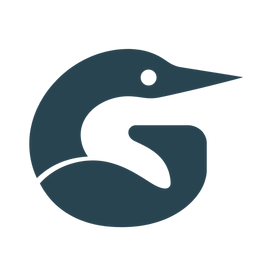
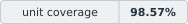
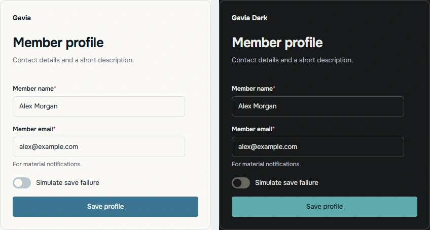

<p align="center">
  
</p>

# Gavia UI

A Vue 3 + TypeScript component library with five themes and explicit CSS imports.

[](https://www.npmjs.com/package/gavia-ui)
[](https://github.com/whitewolf06/gavia-ui/actions/workflows/ci.yml)
[](docs/quality.md)
[](scripts/package-consumer-budget.json)
[](LICENSE)

Prepared source: **1.0.0-rc.1**, not yet published. The candidate uses npm `next`
after publication; ordinary installation follows stable `latest`. Read the
[RC migration](docs/migration-1.0.0-rc.1.md) before opting in.

[](https://whitewolf06.github.io/gavia-ui/)

[Documentation](https://whitewolf06.github.io/gavia-ui/?view=docs&lang=en) ·
[Playground](https://whitewolf06.github.io/gavia-ui/) ·
[Theme builder](https://whitewolf06.github.io/gavia-ui/?view=theme-builder) ·
[Русский](https://whitewolf06.github.io/gavia-ui/?view=docs&lang=ru)

- Vue is the only required peer; the library has no runtime dependencies.
- Native Vue components, typed models, slots and application-owned routing/data.
- Five themes share CSS tokens and component code; reset and styles stay opt-in.
- App-scoped configuration, overlays, confirmation and notification services.
- Working SFC examples and recipes use the same source as the copyable code.
- Contract tests cover keyboard, SSR/hydration, types and installed-package consumers.

### Quick start

```sh
pnpm add gavia-ui vue
```

```vue
<script setup lang="ts">
import { WlButton } from "gavia-ui";
import "gavia-ui/styles/base.css";
import "gavia-ui/styles/fonts/gavia.css";
import "gavia-ui/themes/gavia.css";
</script>

<template>
  <WlButton>Save changes</WlButton>
</template>
```

Set `data-wl-theme="gavia"` on the root element. Import
`gavia-ui/styles/reset.css` before base styles if your application needs the reset.
[Installation and fonts](docs/guide/getting-started.md) · [Migration guide](docs/migration.md).

**Gavia Sans** supplies Cyrillic and Latin, six weights and upright/italic faces.
WOFF2 web fonts ship in npm; TTF desktop files are available through the
[font download](https://whitewolf06.github.io/gavia-ui/?view=font).
Classic, Classic Dark and Newspaper retain their own typography.

[Public TypeScript contracts and upgrading](docs/migration.md).
Measurement dates and scope are documented in [quality and compatibility](docs/maintainers/quality.md#coverage-and-size).

## Themes

### Primary themes

**Gavia** and **Gavia Dark** are light and dark themes with a lake-inspired palette,
shared component dimensions and **Gavia Sans**.

| Theme | Mode | `data-wl-theme` | Package CSS |
| --- | --- | --- | --- |
| **Gavia** | Light | `gavia` | `gavia-ui/themes/gavia.css` |
| **Gavia Dark** | Dark | `gavia-dark` | `gavia-ui/themes/gavia-dark.css` |

Gavia Dark was added in 0.10.0.

### Additional themes

Classic and Classic Dark use a system sans-serif font.
Newspaper also uses a system body font, with serif headings.
All themes share the same components.

| Theme | Appearance | `data-wl-theme` | Package CSS |
| --- | --- | --- | --- |
| **Classic** | Light, neutral | `white` | `gavia-ui/themes/white.css` |
| **Classic Dark** | Dark, neutral | `graphite` | `gavia-ui/themes/graphite.css` |
| **Newspaper** | Light, with serif headings | `newspaper` | `gavia-ui/themes/newspaper.css` |

Choose the theme CSS and identifier from the table. Both primary themes also
require `gavia-ui/styles/fonts/gavia.css`. Without an explicit theme,
the library uses Classic (`white`).

## Application setup

Install the library in a Vue application:

```bash
pnpm add gavia-ui vue
# or
npm install gavia-ui vue
# or
bun add gavia-ui vue
```

Import the styles and font in the entry point, then select Gavia:

```ts
// main.ts
import { createApp } from "vue";
import "gavia-ui/styles/reset.css";
import "gavia-ui/styles/fonts/gavia.css";
import "gavia-ui/styles/base.css";
import "gavia-ui/styles/primitives.css"; // optional layout and typography classes
import "gavia-ui/themes/gavia.css";
import App from "./App.vue";

document.documentElement.dataset.wlTheme = "gavia";
createApp(App).mount("#app");
```

```vue
<script setup lang="ts">
import { WlButton } from "gavia-ui";
</script>

<template>
  <WlButton>Create project</WlButton>
</template>
```

Instead of setting `dataset.wlTheme`, add `<html data-wl-theme="gavia">`
to `index.html`. Gavia Dark uses `gavia-ui/themes/gavia-dark.css` and
`data-wl-theme="gavia-dark"` with the same font CSS. For Classic, Classic Dark
or Newspaper, import `themes/white.css`, `themes/graphite.css` or
`themes/newspaper.css` and select `white`, `graphite` or `newspaper` respectively.
Without the font CSS, both Gavia themes use a system font; without a selected
theme, the library keeps Classic (`white`). `WlConfig` is not required for basic setup.
[Theme names and compatibility](docs/migration-themes.md).
[Detailed setup, API and accessibility](https://whitewolf06.github.io/gavia-ui/?view=docs).

## Documentation and contributing

- [Component guides](https://whitewolf06.github.io/gavia-ui/?view=docs) — examples, controls, API and keyboard states.
- [Design system](docs/design-system.md) — tokens, typography, states and complete interface flows.
- [CSS primitives](docs/primitives.md) and [responsiveness](docs/responsiveness.md) — layout and sizing rules.
- [Gavia / Gavia Dark themes](docs/theme-gavia.md) and [Gavia Sans](docs/font-gavia.md) — palette, setup, specimens and licenses.
- [Changelog](CHANGELOG.md), [upgrade to 0.12.0](docs/migration-0.12.0.md), [type migration for 0.11](docs/migration-0.11.0.md), [0.10 themes](docs/migration-0.10.0.md), [rebranding history](docs/migration-gavia.md) and [verified releases](docs/releases.md) — release history and application upgrades.
- [Localization](docs/localization.md) — explicit library locale and shared EN/RU Playground.
- [Playground architecture](docs/playground.md) and [Pages publication](docs/hosting.md).

## About the author

Hi! I'm [Dmitry Gorbach](https://github.com/whitewolf06). I've been working in commercial software development for over 13 years, mostly in frontend.

I'd wanted to build my own UI kit for pet projects for a long time. There are plenty of existing libraries, but I wanted to decide which components I need, how they behave and where the project goes. And choose dependencies to suit those needs.

That's how Gavia UI started. At first, it was a small set of components for personal projects. As it grew, I decided to try turning it into a full open-source library. Perhaps some of my approaches and solutions will be useful to others.

I enjoy building my own tools, experimenting with technology and turning ideas into working products. I'm also exploring AI assistants and agent-based development, combining them with my engineering experience.

You can contact me through my [personal website](https://gorbach-dev.ru/).

Report bugs and suggestions in [GitHub Issues](https://github.com/whitewolf06/gavia-ui/issues).
Before changing code, read the [contributing guide](CONTRIBUTING.md).

**UI kit code is MIT-licensed.** You may use, modify and distribute the library,
including in commercial projects. Keep the license text and copyright notice.
See [LICENSE](LICENSE) for the full terms.
**Font files are licensed under SIL OFL 1.1:** [font license](packages/ui-kit/fonts/gavia/OFL.txt).

## Development

`packages/ui-kit` is the published library; `apps/playground` is the application
for development and checks. Node.js 22.13+ or 24 and pnpm 10 are required.

```bash
pnpm install
pnpm build              # ESM + TypeScript declarations
pnpm dev                # playground
pnpm test               # Vitest + Vue Test Utils
pnpm typecheck
pnpm build:playground
pnpm run pack           # library archive, without publication
pnpm verify:package     # archive check in an isolated Vue application
```

In a clean checkout, run `pnpm build` first: the playground uses types from
`dist`. Use `pnpm run pack` for the library archive; plain `pnpm pack` at the root
packs the workspace. Browser, token, icon and Pages checks are covered by
[contributing](CONTRIBUTING.md), [playground](docs/playground.md)
and [hosting](docs/hosting.md). Package publication is a separate step:
[release rules](docs/releases.md).

## Contracts and theming

Components preserve `class`/`style`, typed slots and their documented DOM attributes.
Input families align applicable size, density, disabled and invalid states;
status components use semantic tone. Each component's guide lists its actual axes.
`WlConfig` is optional; toast and confirmation services are installed separately
and belong to a specific Vue application. pt settings merge in the order
default → `WlConfig.pt` → instance `pt`; `class` and `style` are merged.
[API and integration](docs/guide/getting-started.md) · [Public DOM and pt](docs/maintainers/architecture.md#themes-and-public-dom).

Themes and local configuration use `--wl-*` CSS custom properties:
foundation → semantic → component. The `wl.reset`, `wl.tokens` and
`wl.components` layers let applications override styles.
Tokens come from `packages/ui-kit/tokens/source.json`; CSS and catalogs
are updated with `pnpm tokens:sync`. Override tokens and select `data-wl-theme`
for a custom theme, keeping components and their DOM contract intact.
[Tokens, themes and complete flows](docs/design-system.md).

[Compatibility, browsers, accessibility and checks](docs/quality.md).
Applications can install the package with pnpm, npm or Bun.
Use pnpm to develop this repository.
