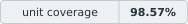
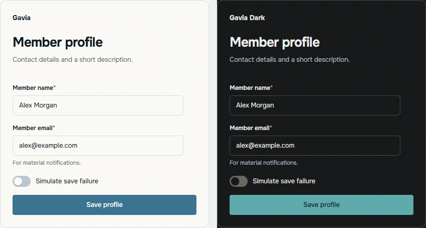

<p align="center">
  
</p>

# Legato UI

A Vue 3 + TypeScript component library with seven themes and explicit CSS imports.

[](https://github.com/whitewolf06/legato-ui/releases/latest)
[](https://github.com/whitewolf06/legato-ui/actions/workflows/ci.yml)
[](docs/maintainers/quality.md)
[](LICENSE)

Starting with 1.2.0, the npm package is `legato-ui`. The previous release remains
available as [gavia-ui@1.1.0](https://www.npmjs.com/package/gavia-ui/v/1.1.0).
The [migration guide](docs/migration.md#migration-1-2) includes an alias for existing imports.
When upgrading from 0.x, start with the [1.0 migration](docs/migration.md#migration-1-0).

[](https://whitewolf06.github.io/legato-ui/)

[Documentation](https://whitewolf06.github.io/legato-ui/docs/) ·
[Playground](https://whitewolf06.github.io/legato-ui/) ·
[Theme builder](https://whitewolf06.github.io/legato-ui/?view=theme-builder) ·
[Русский](https://whitewolf06.github.io/legato-ui/ru/docs/)

- Vue is the only required peer; the library has no runtime dependencies.
- Native Vue components, typed models, slots and application-owned routing/data.
- Seven themes share CSS tokens and component code; reset and styles stay opt-in.
- App-scoped configuration, overlays, confirmation and notification services.
- Working SFC examples and recipes use the same source as the copyable code.
- Contract tests cover keyboard, SSR/hydration, types and installed-package consumers.

## Quick start

For Legato UI 1.2.0 and later, install the package and its Vue peer.

```sh
pnpm add legato-ui vue
# or
npm install legato-ui vue
# or
bun add legato-ui vue
```

Import styles once in your application's entry point, then select Legato.

```ts
// main.ts
import { createApp } from "vue";
import "legato-ui/styles/reset.css"; // optional browser reset
import "legato-ui/styles/base.css";
import "legato-ui/styles/primitives.css"; // optional layout and typography classes
import "legato-ui/styles/fonts/legato.css";
import "legato-ui/themes/legato.css";
import App from "./App.vue";

document.documentElement.dataset.wlTheme = "legato";
createApp(App).mount("#app");
```

```vue
<script setup lang="ts">
import { WlButton } from "legato-ui";
</script>

<template>
  <WlButton>Save changes</WlButton>
</template>
```

Instead of setting `dataset.wlTheme`, add `<html data-wl-theme="legato">`
to `index.html`. `WlConfig` is not required for basic setup.
The reset and primitives imports are optional; keep the reset before base styles.
[Installation and fonts](docs/guide/getting-started.md) · [Migration guide](docs/migration.md).

**Legato Sans** supplies Cyrillic and Latin, variable weights 100–700 and upright/italic faces.
Legato uses `"Legato Sans Core", "Legato Sans", ...` for compact ordinary
text and complete fallback for combining clusters. Firefox uses the complete face
to preserve mark placement. Both original family names remain available.
WOFF2 web fonts ship in npm; TTF desktop files are available through the
[font download](https://whitewolf06.github.io/legato-ui/font/).
Classic, Classic Dark and Newspaper retain their own typography.

[Public TypeScript contracts and upgrading](docs/migration.md).
Measurement dates and scope are documented in [quality and compatibility](docs/maintainers/quality.md#coverage-and-size).

## Themes

### Primary themes

The Playground follows the system appearance with **Legato** and **Legato Dark**. The dark theme pairs ink-colored surfaces with pale indigo, rose and saffron.
**Gavia** and **Gavia Dark** are light and dark themes with a lake-inspired palette,
shared component dimensions and **Gavia Sans**.

| Theme | Mode | `data-wl-theme` | Package CSS |
| --- | --- | --- | --- |
| **Legato** | Light | `legato` | `legato-ui/themes/legato.css` |
| **Legato Dark** | Dark | `legato-dark` | `legato-ui/themes/legato-dark.css` |
| **Gavia** | Light | `gavia` | `legato-ui/themes/gavia.css` |
| **Gavia Dark** | Dark | `gavia-dark` | `legato-ui/themes/gavia-dark.css` |

Gavia Dark was added in 0.10.0.

### Additional themes

Classic and Classic Dark use a system sans-serif font.
Newspaper also uses a system body font, with serif headings.
All themes share the same components.

| Theme | Appearance | `data-wl-theme` | Package CSS |
| --- | --- | --- | --- |
| **Classic** | Light, neutral | `white` | `legato-ui/themes/white.css` |
| **Classic Dark** | Dark, neutral | `graphite` | `legato-ui/themes/graphite.css` |
| **Newspaper** | Light, with serif headings | `newspaper` | `legato-ui/themes/newspaper.css` |

Import `legato-ui/styles/fonts/legato.css` for Legato Sans and the Gavia web aliases.
Existing imports of `legato-ui/styles/fonts/gavia.css` still work.
Without an explicit theme, the library uses Classic (`white`).
[Theme names and compatibility](docs/migration.md#migration-themes).
[Detailed setup, API and accessibility](https://whitewolf06.github.io/legato-ui/docs/).

## Documentation and contributing

- [Component guides](https://whitewolf06.github.io/legato-ui/docs/) — examples, controls, API and keyboard states.
- [Design system](docs/reference/design-system.md) — tokens, typography, states and complete interface flows.
- [CSS primitives](docs/reference/primitives.md) and [responsiveness](docs/reference/responsiveness.md) — layout and sizing rules.
- [Theme setup](docs/guide/theming.md) and [Legato Sans](docs/guide/font-legato.md) — palette, setup, specimens and licenses.
- [Changelog](CHANGELOG.md), [migration guide](docs/migration.md) and [archived release evidence](docs/archive/release-history.md) — release history and application upgrades.
- [Localization](docs/guide/localization.md) — explicit library locale and shared EN/RU Playground.
- [Playground architecture](docs/maintainers/playground.md) and [Pages publication](docs/maintainers/hosting.md).

## About the author

Hi! I'm [Dmitry Gorbach](https://github.com/whitewolf06). I've been working in commercial software development for over 13 years, mostly in frontend.

I'd wanted to build my own UI kit for pet projects for a long time. There are plenty of existing libraries, but I wanted to decide which components I need, how they behave and where the project goes. And choose dependencies to suit those needs.

That's how Legato UI started. At first, it was a small set of components for personal projects. As it grew, I decided to try turning it into a full open-source library. Perhaps some of my approaches and solutions will be useful to others.

I enjoy building my own tools, experimenting with technology and turning ideas into working products. I'm also exploring AI assistants and agent-based development, combining them with my engineering experience.

You can contact me through my [personal website](https://gorbach-dev.ru/).

Report bugs and suggestions in [GitHub Issues](https://github.com/whitewolf06/legato-ui/issues).
Before changing code, read the [contributing guide](CONTRIBUTING.md).

**UI kit code is MIT-licensed.** You may use, modify and distribute the library,
including in commercial projects. Keep the license text and copyright notice.
See [LICENSE](LICENSE) for the full terms.
**Font files are licensed under SIL OFL 1.1:** [font license](packages/ui-kit/fonts/gavia/OFL.txt).

## Development

`packages/ui-kit` is the published library; `apps/playground` is the application
for development and checks. Node.js 22.13+ or 24 and pnpm 10 are required.

```bash
pnpm install
pnpm build              # ESM + TypeScript declarations
pnpm dev                # playground
pnpm test               # Vitest + Vue Test Utils
pnpm typecheck
pnpm build:playground
pnpm run pack           # library archive, without publication
pnpm verify:package     # archive check in an isolated Vue application
```

In a clean checkout, run `pnpm build` first: the playground uses types from
`dist`. Use `pnpm run pack` for the library archive; plain `pnpm pack` at the root
packs the workspace. Browser, token, icon and Pages checks are covered by
[contributing](CONTRIBUTING.md), [playground](docs/maintainers/playground.md)
and [hosting](docs/maintainers/hosting.md). Package publication is a separate step:
[release rules](docs/maintainers/releases.md).

## Contracts and theming

Components preserve `class`/`style`, typed slots and their documented DOM attributes.
Input families align applicable size, density, disabled and invalid states;
status components use semantic tone. Each component's guide lists its actual axes.
`WlConfig` is optional; toast and confirmation services are installed separately
and belong to a specific Vue application. pt settings merge in the order
default → `WlConfig.pt` → instance `pt`; `class` and `style` are merged.
[API and integration](docs/guide/getting-started.md) · [Public DOM and pt](docs/maintainers/architecture.md#themes-and-public-dom).

Themes and local configuration use `--wl-*` CSS custom properties:
foundation → semantic → component. The `wl.reset`, `wl.tokens` and
`wl.components` layers let applications override styles.
Tokens come from `packages/ui-kit/tokens/source.json`; CSS and catalogs
are updated with `pnpm tokens:sync`. Override tokens and select `data-wl-theme`
for a custom theme, keeping components and their DOM contract intact.
[Tokens, themes and complete flows](docs/reference/design-system.md).

[Compatibility, browsers, accessibility and checks](docs/maintainers/quality.md).
Applications can install the package with pnpm, npm or Bun.
Use pnpm to develop this repository.
